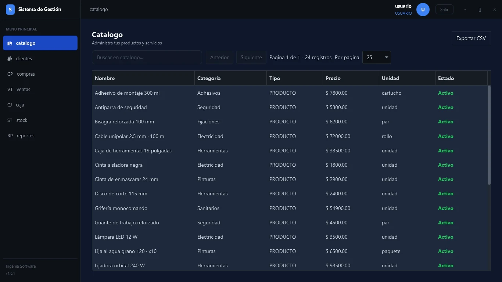
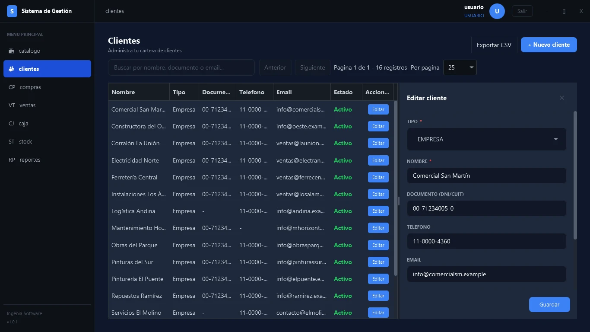
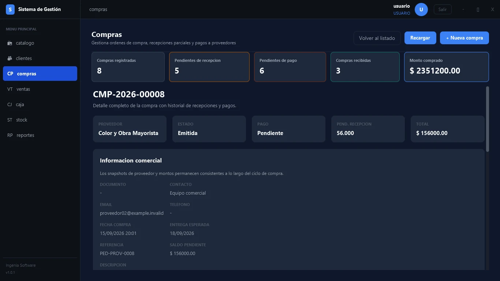
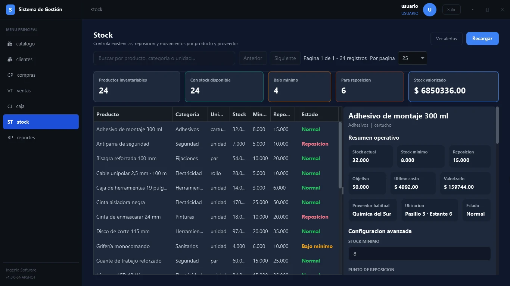

# Gestión Multimódulo

Gestión de ventas, compras, caja y stock en una aplicación organizada por módulos.

| Proyecto | Detalle |
|---|---|
| Tipo | Producto propio en desarrollo |
| Estado | Beta cerrada |
| Tecnologías | Java · JavaFX · Spring Boot · MySQL |
| Desarrollo | Agustin Crudo · Ingenia Software |
| Código de la aplicación | Privado |

Las capturas y el video usan datos de ejemplo.

## El problema

Una venta afecta el stock, el saldo del cliente y la caja. Las compras también modifican las existencias y las cuentas con proveedores. Quise reunir esas operaciones en un producto que mantuviera la información conectada y pudiera adaptarse a distintas empresas.

## Qué desarrollé

- Módulos de catálogo, clientes, proveedores, ventas, compras, caja, stock y reportes.
- Datos, permisos y módulos habilitados por empresa.
- Aplicación de escritorio conectada a un backend central.
- Identificación de solicitudes para evitar operaciones duplicadas cuando se reintenta un envío.

## Mi trabajo

Desarrollo el producto y defino cómo se relacionan sus módulos. Me ocupo de los flujos comerciales, la separación de datos por empresa y las mejoras de la aplicación.

## Desarrollo del producto

Integré los módulos principales sobre un backend común y probé su funcionamiento de forma local y en red LAN. Sigo trabajando en el producto y ajustando los flujos de gestión.

## Video

[Ver o descargar el video MP4 · 33 s](assets/recorrido.mp4)

## Más capturas

**Catálogo**

**Ficha de cliente**

**Detalle de compra**

**Existencias**

## Documentación técnica

- [Arquitectura](docs/arquitectura.md)
- [Decisiones técnicas](docs/decisiones-tecnicas.md)

## Contacto

[Portfolio](https://ingeniasoftwareok.github.io/portfolio/) · [Servicios de Ingenia](https://ingenia-software.com.ar/) · [Contacto personal](mailto:agustincrudo01@gmail.com)
