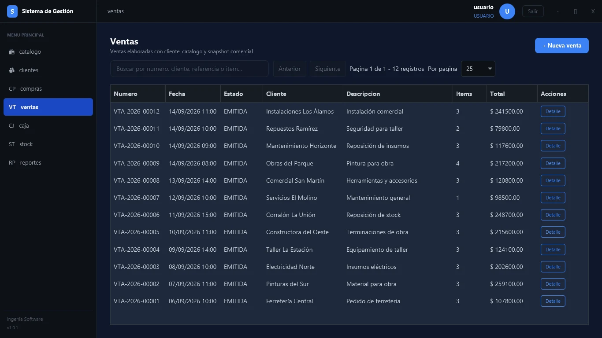

# Gestión Multimódulo

Un producto de gestión empresarial con módulos conectados y separación de datos por empresa.

| Proyecto | Detalle |
|---|---|
| Tipo | Producto propio en desarrollo |
| Estado | Beta cerrada. Sin adopción comercial anunciada. |
| Tecnologías | Java · JavaFX · Spring Boot · MySQL |
| Desarrollo | Agustin Crudo · Ingenia Software |
| Código de la aplicación | Privado; este repositorio presenta el caso |

**Material visual de demostración.** Las cifras de las pantallas no son resultados comerciales.

## Recorrido visual

[Ver o descargar el video MP4 · 33 s](assets/recorrido.mp4) · [Descripción del recorrido](docs/recorrido.md) · [Rótulos descriptivos VTT](assets/recorrido.es.vtt)

El montaje muestra catálogo, clientes, ventas, detalle de compra y existencias. Son consultas y navegación con datos ficticios; no demuestra una venta nueva que actualice stock y caja. Las tomas pertenecen a versiones de demostración diferentes.

## El problema

Las operaciones de catálogo, clientes, ventas, compras, caja y stock están relacionadas. El producto busca organizarlas mediante módulos y accesos definidos por empresa, sin perder coherencia entre las operaciones.

## La solución

- Cliente de escritorio que consume un backend central.
- Módulos comerciales habilitados según empresa y permisos: catálogo, clientes, proveedores, ventas, compras, caja, stock y reportes, entre otros.
- Controles de separación de datos y tratamiento de reintentos para evitar duplicar operaciones.

## Mi participación

Desarrollo del producto y dirección de su evolución mediante un proceso mixto de programación y herramientas de IA. El caso se centra en cómo se conectan las operaciones de gestión y qué decisiones sostienen el comportamiento del sistema.

## Resultado y estado

Se construyó una plataforma con módulos operativos y ensayos locales/LAN documentados. El proyecto permanece en beta cerrada según el último estado confirmado.

## Decisiones y alcance

- [Arquitectura simplificada](docs/arquitectura.md)
- [Decisiones técnicas seleccionadas](docs/decisiones-tecnicas.md)
- [Qué demuestra el material y qué queda fuera](docs/alcance-evidencia.md)

Más capturas del proyecto

**Catálogo**

**Ficha de cliente ficticio**

**Detalle de compra**

**Existencias**

## Disponibilidad del código

Este repositorio contiene documentación y material audiovisual del caso. El código fuente de la aplicación se mantiene privado. Los diagramas son explicaciones simplificadas, no instrucciones de despliegue ni una distribución del sistema.

## Contacto

[Agustin Crudo · Ingenia Software](https://github.com/IngeniaSoftwareok) · [Portfolio](https://ingeniasoftwareok.github.io/portfolio/) · [Web profesional](https://ingenia-software.com.ar/) · [Email](mailto:ingeniasoftwareok@gmail.com)
