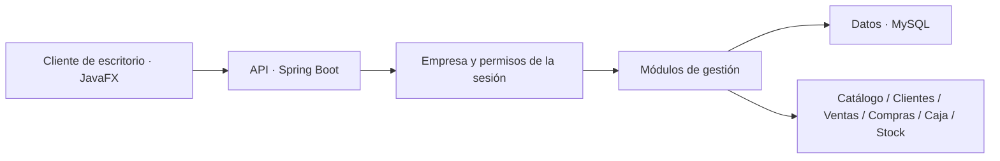

# Arquitectura

Organicé el producto en una aplicación de escritorio, una API central y módulos de negocio que comparten servicios y datos.

## Cliente y API

JavaFX presenta las pantallas de trabajo y consume la API de Spring Boot. El backend procesa las operaciones y concentra las reglas comunes.

## Empresas y permisos

Cada solicitud utiliza la empresa de la sesión. El backend aplica ese contexto a los datos y valida los permisos necesarios para la operación.

## Módulos

Los módulos forman parte de la aplicación y se habilitan por empresa. Comparten el núcleo de servicios para conectar las operaciones de ventas, compras, caja y existencias.
