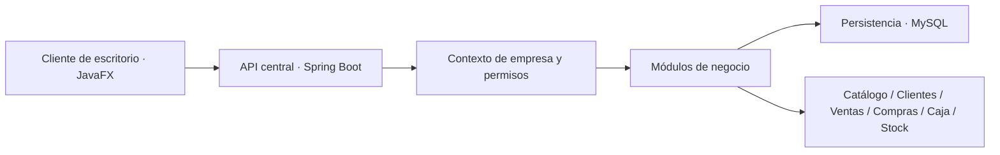

# Arquitectura del caso

Vista conceptual de la plataforma; los nombres representan responsabilidades, no infraestructura productiva publicada.

El cliente consume la API: no es una aplicación web ni una herramienta completamente sin conexión. Los módulos forman parte del build y se habilitan según la empresa.

El núcleo conserva responsabilidades transversales y los módulos organizan el negocio. Esta presentación no distribuye tablas internas, scripts de despliegue, secretos o una copia del producto.
